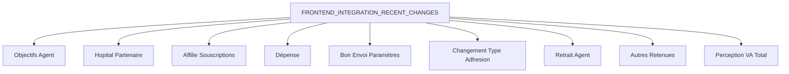

# Intégration Frontend — Changements récents Prosoc API

Point d'entrée unique pour l'intégration des **10 évolutions** déployées récemment côté API. Chaque module possède un guide détaillé avec endpoints, permissions, exemples JSON et checklist UI.

Documents complémentaires globaux :

- [`API-DOCUMENTATION-NEW.md`](API-DOCUMENTATION-NEW.md) — référence API
- [`INSTRUCTIONS-DEPLOIEMENT.md`](INSTRUCTIONS-DEPLOIEMENT.md) — déploiement général

---

## Prérequis communs

| Élément | Détail |
|---|---|
| Authentification | JWT Bearer — `Authorization: Bearer <token>` |
| Format JSON | **camelCase** (sérialisation ASP.NET Core) |
| Base URL | ex. `https://dev-prosoc.asdc-rdc.org` (**sans** suffixe `/api`) |
| Permissions | Claims multiples `permission` dans le JWT |
| Admin / SuperAdmin | Bypass des contrôles `HasPermission` côté serveur |

### Reconnexion après déploiement

Après exécution des scripts SQL de permissions en UAT/production, demander aux utilisateurs concernés de **se reconnecter** pour rafraîchir le JWT.

---

## Index des changements

| # | Changement | Guide détaillé | Statut doc |
|---|------------|----------------|------------|
| 1 | TargetCotisation (objectifs cotisations) | [`FRONTEND_INTEGRATION_OBJECTIFS_AGENT.md`](FRONTEND_INTEGRATION_OBJECTIFS_AGENT.md) | Nouveau |
| 2 | Target × nombre d'adhésions (dashboards) | [`FRONTEND_INTEGRATION_OBJECTIFS_AGENT.md`](FRONTEND_INTEGRATION_OBJECTIFS_AGENT.md) | Nouveau |
| 3 | Code d'accès hôpital auto-généré | [`FRONTEND_INTEGRATION_HOPITAL_PARTENAIRE.md`](FRONTEND_INTEGRATION_HOPITAL_PARTENAIRE.md) | Nouveau |
| 4 | Affilié — voir ses propres souscriptions | [`FRONTEND_INTEGRATION_AFFILIE_SOUSCRIPTIONS.md`](FRONTEND_INTEGRATION_AFFILIE_SOUSCRIPTIONS.md) | Nouveau |
| 5 | Module décaissement (Dépense) | [`FRONTEND_INTEGRATION_DEPENSE.md`](FRONTEND_INTEGRATION_DEPENSE.md) | Nouveau |
| 6 | Durée jeton Demande Bon Envoi | [`FRONTEND_INTEGRATION_BON_ENVOI_PARAMETRES.md`](FRONTEND_INTEGRATION_BON_ENVOI_PARAMETRES.md) | Nouveau |
| 7 | Changement de TypeAdhesion | [`FRONTEND_INTEGRATION_CHANGEMENT_TYPE_ADHESION.md`](FRONTEND_INTEGRATION_CHANGEMENT_TYPE_ADHESION.md) | Nouveau |
| 8 | Retrait agent — pourcentage max PARTIEL (25 % prod) | [`FRONTEND_INTEGRATION_RETRAIT_AGENT.md`](FRONTEND_INTEGRATION_RETRAIT_AGENT.md) | Mis à jour |
| 9 | Autres retenues agent (IRPP/CNSS) | [`FRONTEND_INTEGRATION_AUTRES_RETENUES_AGENT.md`](FRONTEND_INTEGRATION_AUTRES_RETENUES_AGENT.md) | Existant |
| 10 | Encaissement VA total (Caissier / Percepteur) | [`FRONTEND_INTEGRATION_HISTORIQUE_ENCAISSEMENTS.md`](FRONTEND_INTEGRATION_HISTORIQUE_ENCAISSEMENTS.md) §5b | Mis à jour |

---

## Matrice rapide rôle → permissions → écrans

| Rôle | Permissions clés | Écrans impactés |
|---|---|---|
| **Admin / IT** | `MANAGE_OBJECTIFS`, `UPDATE_PARAMETRES_METIER`, `CREATE_HOPITAL_PARTENAIRE` | Objectifs, paramètres retrait/bon-envoi, hôpitaux |
| **Financier** | `READ_TARGET_COTISATION`, `CHANGE_TYPE_ADHESION`, `READ_DEPENSE`, `CREATE_DEPENSE` | Reporting objectifs, changement type adhésion, dépenses |
| **Agent (AT)** | JWT rôle `Agent (AT)` | Dashboard objectifs (`/api/DashboardAgent/objectifs`) |
| **Caissier** | `CREATE_DEPENSE`, `CONFIRM_PERCEPTION_VIRTUAL`, `OPEN_CAISSIER_SESSION` | Dépenses, encaissement VA total |
| **Percepteur** | `READ_PERCEPTION_VIRTUAL`, `CONFIRM_PERCEPTION_VIRTUAL` | Encaissement VA total, historique |
| **Affilié** | `READ_SOUSCRIPTION_PRESTATION`, `PAIEMENT_AFFILIE` | Mes souscriptions, paiement |

---

## Checklist déploiement SQL (UAT / production)

Exécuter les scripts idempotents **avant** de tester l'intégration frontend :

```bash
# 1–2 Objectifs (TargetCotisation)
mysql -h <host> -u <user> -p <database> < sql/MigrateTargetCotisation.idempotent.sql
mysql -h <host> -u <user> -p <database> < sql/MigrateFinancierReadTargetAgent.idempotent.sql

# 3 Hôpital — code accès unique
mysql -h <host> -u <user> -p <database> < sql/MigrateHopitalPartenaireCodeAccesUnique.idempotent.sql
mysql -h <host> -u <user> -p <database> < sql/MigrateHopitalPartenaireCrudPermissions.idempotent.sql

# 4 Affilié souscriptions
mysql -h <host> -u <user> -p <database> < sql/MigrateAffilieRolePermissions.idempotent.sql

# 5 Dépense
mysql -h <host> -u <user> -p <database> < sql/MigrateDepense.idempotent.sql
mysql -h <host> -u <user> -p <database> < sql/MigrateDepensePermissions.idempotent.sql

# 6 Bon Envoi — durée jeton
mysql -h <host> -u <user> -p <database> < sql/MigrateBonEnvoiParametresMetier.idempotent.sql
mysql -h <host> -u <user> -p <database> < sql/MigrateParametresMetierPermissions.idempotent.sql

# 7 Changement TypeAdhesion
mysql -h <host> -u <user> -p <database> < sql/MigrateChangementTypeAdhesion.idempotent.sql
mysql -h <host> -u <user> -p <database> < sql/MigrateChangementTypeAdhesionPermissions.idempotent.sql

# 8 Retrait agent — pourcentage max PARTIEL
mysql -h <host> -u <user> -p <database> < sql/MigrateRetraitAgentPourcentageMaxPartiel.idempotent.sql

# 9 Autres retenues
mysql -h <host> -u <user> -p <database> < sql/MigrateAutresRetenuesAgentPermissions.idempotent.sql

# 10 Perception VA (si pas déjà déployé)
mysql -h <host> -u <user> -p <database> < sql/MigratePerceptionVirtuellePermissions.idempotent.sql
```

Puis **reconnexion JWT** pour tous les rôles concernés.

---

## Navigation recommandée



---

## Checklist intégration globale

- [ ] Scripts SQL exécutés en UAT
- [ ] Utilisateurs reconnectés (JWT à jour)
- [ ] Menus filtrés par claims `permission`
- [ ] Payloads camelCase vérifiés
- [ ] Erreurs métier (`code`, `codeErreur`) affichées à l'utilisateur
- [ ] Session caisse ouverte avant dépense / perception VA
