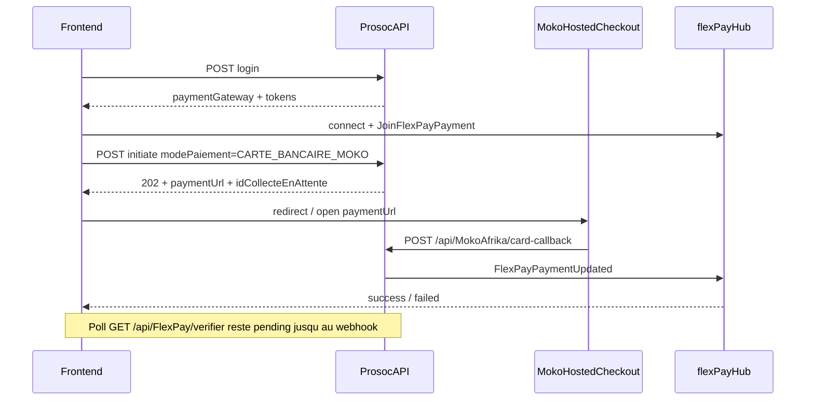

# Frontend Integration — Carte bancaire MokoAfrika (`CARTE_BANCAIRE_MOKO`)

Guide d’intégration **Web (Vue.js)** et **Mobile (Flutter)** pour le Hosted Checkout carte MokoAfrika.

Ops / secrets backend : [`docs/integration-moko-afrika-prosoc.md`](docs/integration-moko-afrika-prosoc.md)  
Collecte FlexPay (MM / carte FlexPay) : [`FRONTEND_INTEGRATION_COLLECTE_FLEXPAY.md`](FRONTEND_INTEGRATION_COLLECTE_FLEXPAY.md)  
Adhésion FlexPay : [`FRONTEND_INTEGRATION_ADHESION_FLEXPAY.md`](FRONTEND_INTEGRATION_ADHESION_FLEXPAY.md)  
Référence API : [`API-DOCUMENTATION-NEW.md`](API-DOCUMENTATION-NEW.md) (section MOKO / FlexPay)

---

## 1) Vue d’ensemble — double stack carte

Le frontend **choisit** le mode. Le backend ne remplace pas FlexPay carte.

| Mode FE (`modePaiement`) | Backend | Redirect navigateur / WebView |
|--------------------------|---------|-------------------------------|
| `CARTE_BANCAIRE` | FlexPay carte (inchangé) | `paymentUrl` FlexPay |
| `CARTE_BANCAIRE_MOKO` | Hosted Checkout Moko | `paymentUrl` (= `data.links` Moko) |
| `MOBILE_MONEY` | Provider MM (`PaymentGateway.provider`) | Pas d’URL obligatoire (push opérateur) |

Alias acceptés pour Moko carte : `CARTE_MOKO`, `MOKO_CARD`, `CARD_MOKO`.

Réponse d’initiation **identique** aux flux FlexPay : `InitiateFlexPayResponseDto` (`202` / `200` selon l’endpoint).



Points clés :

- Finalisation métier **uniquement** après webhook serveur (pas après redirect retour page).
- SignalR event : `FlexPayPaymentUpdated` (même hub que FlexPay).
- Frais carte Moko : déjà inclus côté serveur dans `montantFlexPay` (grille `card`). Afficher `montantFlexPay` à l’utilisateur, pas seulement le tarif net.
- Flag marchand : `actifCarteBancaireMoko` doit être `true` sinon l’initiation échoue.

---

## 2) Découverte config au login

`POST /api/Utilisateur/login` renvoie (succès) :

```json
{
  "success": true,
  "accessToken": "...",
  "paymentGateway": {
    "provider": "MokoAfrika",
    "cardProvider": null,
    "commissionPercentage": 3.5
  },
  "utilisateur": { }
}
```

| Champ | Usage FE |
|-------|----------|
| `provider` | Gateway **Mobile Money** actif (`FlexPay` ou `MokoAfrika`) |
| `cardProvider` | Override carte FlexPay (`CARTE_BANCAIRE`) ; `null` = hybride (carte FlexPay si MM = Moko) |
| `commissionPercentage` | **Info affichage** (ex. badge « ~3,5 % ») — le montant exact reste `montantFlexPay` après initiation |

**Ne pas** déduire `CARTE_BANCAIRE_MOKO` uniquement de `provider`. L’option Hosted Checkout Moko est un **mode explicite** + flag marchand.

### Flags marchand

`GET /api/InfoPaiementMarchand/actif` (ou liste admin) :

| Champ | UI |
|-------|-----|
| `actifMobileMoney` | Afficher MM |
| `actifCarteBancaire` | Afficher **Carte FlexPay** (`CARTE_BANCAIRE`) |
| `actifCarteBancaireMoko` | Afficher **Carte Moko** (`CARTE_BANCAIRE_MOKO`) |

---

## 3) Endpoints métier

Même routes que FlexPay ; seul `modePaiement` change.

| Endpoint | Auth | Réponse succès |
|----------|------|----------------|
| `POST /api/Collecte/with-paiement-electronique` | Public | `202` + `InitiateFlexPayResponseDto` |
| `POST /api/Adhesion/with-affilie-paiement-electronique` | Public | `202` + `InitiateFlexPayResponseDto` |
| `POST /api/SouscriptionPrestation/paiement-electronique` | JWT | `202` + `InitiateFlexPayResponseDto` |
| `POST /api/Collecte` (agent) | JWT | `200` + `InitiateFlexPayResponseDto` si mode électronique |
| `POST /api/Affilie/paiement` | JWT | `200` + `InitiateFlexPayResponseDto` |

### Exemple collect publique (carte Moko)

```json
{
  "modePaiement": "CARTE_BANCAIRE_MOKO",
  "devisePaiementId": 1,
  "collecte": {
    "typeCollecte": "FRAIS",
    "fraisId": 3,
    "affilieId": 42,
    "agentId": 7,
    "montant": 0,
    "mois": 8,
    "annee": 2026,
    "modePaiement": "CARTE_BANCAIRE_MOKO",
    "deviseId": 1,
    "statut": true
  }
}
```

- `telephonePaiement` : **non requis** pour carte (contrairement au MM).
- Pas de mélange avec `ESPECE` / `VIRTUAL_ACCOUNT` sur les endpoints électroniques.

### Réponse `InitiateFlexPayResponseDto` (camelCase)

| Champ | Rôle FE |
|-------|---------|
| `idCollecteEnAttente` | `JoinFlexPayPayment` |
| `orderNumberFlexPay` | Poll `verifier` (= `transaction_uuid` Moko) |
| `referenceFlexPay` | Suivi / support |
| `montantFlexPay` | Montant réellement débité (frais inclus) |
| `codeDevisePaiement` | `CDF` / `USD` |
| `paymentUrl` | **Obligatoire** pour redirect Hosted Checkout |
| `holdExpireAt` | Timeout UI |
| `flexPayAccepted` | Initiation gateway OK |
| `message` | Texte utilisateur |

Si `paymentUrl` est vide / null → **ne pas** rediriger ; afficher erreur.

Webhook carte (côté serveur, transparent FE) : `POST /api/MokoAfrika/card-callback` — le FE n’appelle jamais cet endpoint.

---

## 4) SignalR + poll (Web et Mobile)

| Élément | Valeur |
|---------|--------|
| Hub | `{apiBase}/flexPayHub` |
| Join | `JoinFlexPayPayment(idCollecteEnAttente)` |
| Leave | `LeaveFlexPayPayment(idCollecteEnAttente)` |
| Event | `FlexPayPaymentUpdated` |
| Auth hub | Non requis pour flux publics |

### Payload `FlexPayPaymentUpdated`

| Champ | Signification |
|-------|----------------|
| `success` | Paiement finalisé OK (collecte / adhésion créée) |
| `failed` | Refus définitif (callback échec) |
| `alreadyProcessed` | Idempotence (déjà finalisé) |
| `idCollecte` / `idAdhesion` | IDs métier |
| `sourceFlux` | Ex. `CollectePaiementElectroniquePublic`, `AdhesionWithAffilie` |
| `message` | Détail |
| `orderNumberFlexPay` / `referenceFlexPay` | Corrélation |

### Poll secours

`GET /api/FlexPay/verifier/{orderNumber}`

Pour **`CARTE_BANCAIRE_MOKO`**, le check reste en général **`pending`** jusqu’au webhook (pas d’API status Hosted Checkout branchée comme finalize).

Règles FE :

1. Continuer le poll tant que `pending === true` (et hold non expiré).
2. Succès UI seulement si SignalR `success` / `alreadyProcessed`, ou réponse verifier avec `idCollecte` / `idAdhesion`.
3. Ne pas traiter un `pending` comme refus.

Ordre recommandé : **connecter SignalR → initiate → join → redirect `paymentUrl`**.

---

## 5) Vue.js (Web)

### 5.1 Choix UI des modes

```ts
type ModePaiement =
  | 'MOBILE_MONEY'
  | 'CARTE_BANCAIRE'
  | 'CARTE_BANCAIRE_MOKO';

function modesDisponibles(marchand: {
  actifMobileMoney: boolean;
  actifCarteBancaire: boolean;
  actifCarteBancaireMoko: boolean;
}): ModePaiement[] {
  const modes: ModePaiement[] = [];
  if (marchand.actifMobileMoney) modes.push('MOBILE_MONEY');
  if (marchand.actifCarteBancaire) modes.push('CARTE_BANCAIRE');
  if (marchand.actifCarteBancaireMoko) modes.push('CARTE_BANCAIRE_MOKO');
  return modes;
}
```

Afficher éventuellement `paymentGateway.commissionPercentage` en hint sous l’option Moko carte.

### 5.2 Flux TypeScript (SignalR + redirect)

Dépendance : `@microsoft/signalr`

```ts
import * as signalR from '@microsoft/signalr';

const apiBase = import.meta.env.VITE_API_BASE_URL; // ex. https://uat-prosoc.asdc-rdc.org

async function payerCarteMoko(payload: unknown) {
  const connection = new signalR.HubConnectionBuilder()
    .withUrl(`${apiBase}/flexPayHub`)
    .withAutomaticReconnect()
    .build();

  connection.on('FlexPayPaymentUpdated', (p: {
    success: boolean;
    failed: boolean;
    alreadyProcessed: boolean;
    idCollecte?: number;
    idAdhesion?: number;
    message: string;
  }) => {
    if (p.success || p.alreadyProcessed) {
      // router.push({ name: 'paiement-ok', params: { idCollecte: p.idCollecte } })
    } else if (p.failed) {
      // toast erreur p.message
    }
  });

  await connection.start();

  const res = await fetch(`${apiBase}/api/Collecte/with-paiement-electronique`, {
    method: 'POST',
    headers: { 'Content-Type': 'application/json' },
    body: JSON.stringify(payload),
  });

  if (res.status !== 202) {
    const err = await res.json().catch(() => ({}));
    throw new Error(err.message ?? `HTTP ${res.status}`);
  }

  const data = await res.json() as {
    idCollecteEnAttente: string;
    orderNumberFlexPay?: string;
    paymentUrl?: string;
    montantFlexPay: number;
    holdExpireAt: string;
  };

  await connection.invoke('JoinFlexPayPayment', data.idCollecteEnAttente);

  if (!data.paymentUrl) {
    await connection.stop();
    throw new Error('paymentUrl manquant — Hosted Checkout non initié');
  }

  // Redirect même onglet (ou window.open pour nouvel onglet)
  window.location.href = data.paymentUrl;

  // Optionnel : poll de secours si l’utilisateur revient sans SignalR
  // startVerifierPolling(data.orderNumberFlexPay, data.holdExpireAt)
}
```

### 5.3 Retour après paiement

Après Hosted Checkout, l’utilisateur peut revenir sur une page approve/cancel générique ou rester sur le site Moko. **La source de vérité** reste SignalR (ou poll). Sur la page d’attente Prosoc :

- Afficher « Paiement en cours… » tant que ni `success` ni `failed`.
- Respecter `holdExpireAt`.

---

## 6) Flutter (Mobile)

### 6.1 Packages suggérés

| Besoin | Package typique |
|--------|-----------------|
| HTTP | `dio` / `http` |
| SignalR | `signalr_netcore` (ou client SignalR du projet) |
| Ouvrir checkout | `url_launcher` (navigateur externe) **ou** `webview_flutter` (in-app) |

Recommandation produit : **navigateur externe** (`LaunchMode.externalApplication`) pour 3-D Secure / wallets bancaires ; garder l’app en écoute SignalR.

### 6.2 Exemple Dart minimal

```dart
import 'dart:convert';
import 'package:http/http.dart' as http;
import 'package:url_launcher/url_launcher.dart';
// import signalr selon le package choisi

Future<void> payerCarteMoko({
  required String apiBase,
  required Map<String, dynamic> payload,
  required void Function(Map<String, dynamic> event) onPaymentUpdated,
}) async {
  // 1) Connecter le hub /flexPayHub et écouter FlexPayPaymentUpdated
  //    (détails selon signalr_netcore / wrapper projet)
  // await hub.start();
  // hub.on('FlexPayPaymentUpdated', onPaymentUpdated);

  final res = await http.post(
    Uri.parse('$apiBase/api/Collecte/with-paiement-electronique'),
    headers: {'Content-Type': 'application/json'},
    body: jsonEncode(payload),
  );

  if (res.statusCode != 202) {
    throw Exception('Initiation échouée: ${res.statusCode} ${res.body}');
  }

  final data = jsonDecode(res.body) as Map<String, dynamic>;
  final idEnAttente = data['idCollecteEnAttente'] as String;
  final paymentUrl = data['paymentUrl'] as String?;

  // await hub.invoke('JoinFlexPayPayment', args: [idEnAttente]);

  if (paymentUrl == null || paymentUrl.isEmpty) {
    throw Exception('paymentUrl manquant');
  }

  final uri = Uri.parse(paymentUrl);
  final ok = await launchUrl(uri, mode: LaunchMode.externalApplication);
  if (!ok) throw Exception('Impossible d’ouvrir le Hosted Checkout');

  // 2) Rester sur un écran "Paiement en cours" jusqu’à onPaymentUpdated
  // 3) Optionnel: poll GET $apiBase/api/FlexPay/verifier/$orderNumber
}
```

### 6.3 Retour dans l’app

Sans deep-link Moko dédié : l’utilisateur revient manuellement ; l’écran d’attente doit déjà avoir reçu `FlexPayPaymentUpdated` via SignalR (app en arrière-plan : reconnect + poll au `resume`).

Si vous ajoutez un deep-link (`myapp://paiement-retour`), utilisez-le seulement pour **rouvrir** l’écran d’attente — ne finalisez pas le métier côté client.

### 6.4 WebView in-app (alternative)

Si `webview_flutter` :

- Charger `paymentUrl`.
- Ne pas parser le HTML Moko pour conclure succès.
- Continuer à écouter SignalR / poll.

---

## 7) Erreurs fréquentes & checklist QA

| Symptôme | Cause probable | Action FE |
|----------|----------------|-----------|
| 400 / message marchand carte Moko | `actifCarteBancaireMoko = false` | Masquer l’option ou message admin |
| `paymentUrl` null | Config `CardApiKey` / gateway | Afficher erreur, ne pas rediriger |
| SignalR OK mais pas d’event | Pas de `JoinFlexPayPayment` | Join **après** `202` avec le bon GUID |
| Poll toujours pending | Normal carte Moko | Attendre webhook / SignalR |
| Montant UI ≠ débit | Affichage tarif net | Afficher `montantFlexPay` |

### Checklist QA sandbox

1. Marchand : `actifCarteBancaireMoko = true`.
2. Login : `paymentGateway` présent.
3. Initiate `CARTE_BANCAIRE_MOKO` → `202`, `paymentUrl` non vide, `montantFlexPay` > tarif si frais.
4. Redirect Hosted Checkout → payer sandbox.
5. Recevoir `FlexPayPaymentUpdated` (`success` + `idCollecte` / `idAdhesion`).
6. (Ops) DB : `TypePaiement = 3`, `CallbackUrl` contient `/api/MokoAfrika/card-callback`.
7. Vérifier que `CARTE_BANCAIRE` (FlexPay) n’est **pas** cassé en parallèle.

---

## 8) Récap contrat FE

| Item | Valeur |
|------|--------|
| Mode | `CARTE_BANCAIRE_MOKO` |
| Redirect | `paymentUrl` obligatoire |
| Hub | `/flexPayHub` → `JoinFlexPayPayment` → `FlexPayPaymentUpdated` |
| Finalize | Serveur uniquement (card-callback) |
| Poll | Secours ; pending jusqu’au webhook |
| Affichage montant | `montantFlexPay` |
| Flag | `actifCarteBancaireMoko` |
