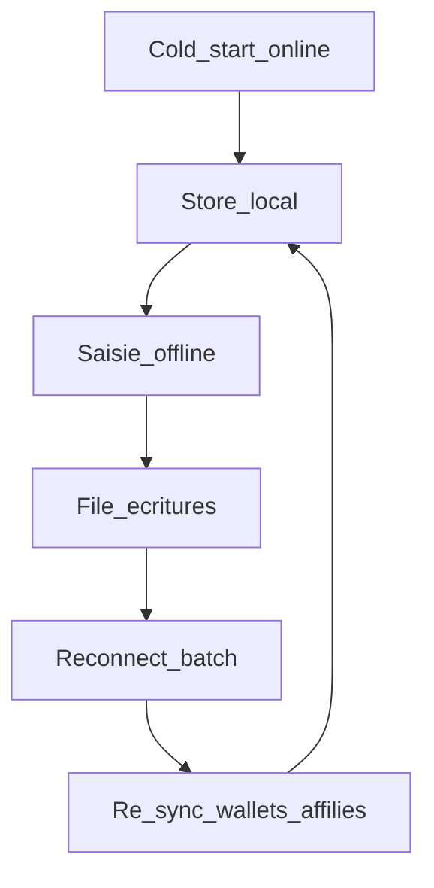

# Intégration Frontend — Mode Offline / Sync

Guide d’intégration pour le **mode hors ligne** terrain (AT et Chef d’équipe) : snapshot local en lecture + file d’écritures idempotentes en `VIRTUAL_ACCOUNT`.

Documents complémentaires :

- [`PROSOC_PORTABLE_INTEGRATION_OFFLINE_SYNC.md`](PROSOC_PORTABLE_INTEGRATION_OFFLINE_SYNC.md) — contrat HTTP / architecture portable
- [`Kelasi_PORTABLE_INTEGRATION_OFFLINE_SYNC.md`](Kelasi_PORTABLE_INTEGRATION_OFFLINE_SYNC.md) — patterns génériques (watermark, cursor, batch)
- [`FRONTEND_INTEGRATION_CHEF_EQUIPE.md`](FRONTEND_INTEGRATION_CHEF_EQUIPE.md) — périmètre zone Chef
- [`sql/MigrateOfflineSyncPermissions.idempotent.sql`](sql/MigrateOfflineSyncPermissions.idempotent.sql) — table + permissions

**Source de vérité API** : `Controllers/SyncController.cs`, `Models/DTOs/Sync/OfflineSyncDtos.cs`.

---

## Prérequis

| Élément | Détail |
|---|---|
| Authentification | JWT Bearer — `Authorization: Bearer <token>` |
| Format JSON | **camelCase** |
| Base URL | ex. `https://dev-prosoc.asdc-rdc.org` (**sans** suffixe `/api`) |
| Rôles v1 | `Agent (AT)`, `Chef d'équipe` |
| Permissions | `READ_SYNC` (lecture), `WRITE_SYNC` (batch) |
| Déploiement | Exécuter le SQL idempotent puis **reconnexion JWT** AT / Chef |

---

## Périmètre v1

| Inclus | Exclus |
|---|---|
| Lecture affiliés du scope + référentiels + soldes wallet | CRUD affilié hors file d’écritures |
| Collecte `VIRTUAL_ACCOUNT` offline | FlexPay / Moko / Mobile Money / carte async |
| Adhésion + affilié `VIRTUAL_ACCOUNT` offline | `ESPECE`, perception virtuelle, session caisse |
| Idempotence via `clientRequestId` | Recharge wallet, bon d’envoi |

---

## Cycle FE recommandé



1. **Cold start** (online) : `bootstrap` → `referentials` → pages `affilies` / `wallets` / `souscriptions-prestations` jusqu’à `hasMore === false` → persister `watermark` / `nextSince`.
2. **Delta périodique** (online) : mêmes endpoints avec `since` + `cursor` ; puis `deletions?since=…`.
3. **Offline** : UI lecture sur le store local ; créations uniquement dans la **file** avec UUID figé.
4. **Reconnect** : `POST /api/sync/writes/batch` → traiter chaque `status`.
5. **Après batch** : re-sync `wallets` (+ `affilies` si adhésions créées).

---

## Permissions

| Permission | Rôles | Usage |
|---|---|---|
| `READ_SYNC` | Agent (AT), Chef d’équipe, Admin, Superviseur | Bootstrap, référentiels, affiliés, wallets, souscriptions prestations, deletions |
| `WRITE_SYNC` | Agent (AT), Chef d’équipe, Admin, Superviseur | Upload batch |

Sans ces claims après déploiement SQL → **403**. Forcer une reconnexion.

---

## Endpoints — `/api/sync`

Tous : `[Authorize]`.

| Méthode | Route | Permission | Rôle |
|---|---|---|---|
| `GET` | `/api/sync/bootstrap` | `READ_SYNC` | Snapshot initial + watermark |
| `GET` | `/api/sync/referentials` | `READ_SYNC` | Catalogue métier |
| `GET` | `/api/sync/affilies` | `READ_SYNC` | Delta affiliés (scope) |
| `GET` | `/api/sync/wallets` | `READ_SYNC` | Delta wallets (scope) |
| `GET` | `/api/sync/souscriptions-prestations` | `READ_SYNC` | Souscriptions prestations des affiliés du scope |
| `GET` | `/api/sync/deletions` | `READ_SYNC` | Purge (`since` **obligatoire**) |
| `POST` | `/api/sync/writes/batch` | `WRITE_SYNC` | Upload file |

### Query commune (pages)

| Paramètre | Obligatoire | Notes |
|---|---|---|
| `since` | non (sauf deletions) | Watermark opaque renvoyé par le serveur |
| `cursor` | non | Pagination opaque ; boucler tant que `hasMore` |
| `pageSize` | non | Défaut **1000**, max **5000** |
| `snapshot` | non | Cohérence de session de sync ; réutiliser celui de la page courante |

---

## 1) Bootstrap

```http
GET /api/sync/bootstrap
Authorization: Bearer {jwt}
```

Exemple de réponse :

```json
{
  "schemaVersion": "1.0",
  "watermark": "2026-10-13T12:00:00.0000000Z_0",
  "snapshot": "a1b2c3…",
  "affiliesCount": 42,
  "walletsCount": 1,
  "plafondWalletVirtuel": 500,
  "wallets": [
    {
      "idWalletVirtuelAgent": 7,
      "agentId": 5,
      "agentNom": "AT Exemple",
      "agentMatricule": "AT0001",
      "deviseId": 1,
      "deviseCode": "USD",
      "soldeVirtuel": 120.5,
      "statut": true,
      "updatedAt": "2026-10-13T11:55:00"
    }
  ]
}
```

**FE** : persister `watermark`, `schemaVersion`, `plafondWalletVirtuel` et les wallets.

---

## 2) Référentiels

```http
GET /api/sync/referentials?since={watermark}
```

Réponse : `typeAdhesions`, `devises`, `provinces`, `frais`, `prestations`, `tarifsCotisation`, `plafondWalletVirtuel`, `nextSince`, `snapshot`.

**FE** : upsert local par id ; mémoriser `nextSince` après succès.

---

## 3) Affiliés (pages)

```http
GET /api/sync/affilies?since={watermark}&cursor={cursor}&pageSize=1000&snapshot={snapshot}
```

Item type :

```json
{
  "idAffilie": 10,
  "codeAdhesion": "SOLO-…",
  "nom": "Dupont",
  "prenom": "Jean",
  "nomComplet": "Jean Dupont",
  "dateNaissance": "1990-01-01T00:00:00",
  "sexe": "Masculin",
  "telephone": "0991234567",
  "provinceResidence": "Kinshasa",
  "adhesionId": 99,
  "agentGestionnaireId": 5,
  "typeAdhesionId": 1,
  "statutDossier": "VALIDE",
  "statut": true,
  "updatedAt": "2026-10-13T10:00:00",
  "isDeleted": false
}
```

Pagination :

```json
{
  "snapshot": "…",
  "items": [ /* … */ ],
  "nextCursor": "aWQ6MTI=",
  "hasMore": true,
  "nextSince": "2026-10-13T12:05:00.0000000Z_12"
}
```

**Boucle** : tant que `hasMore`, rappeler avec `cursor = nextCursor` et le même `snapshot`.

**Scope** :

- AT → affiliés où `agentGestionnaireId` = soi
- Chef → affiliés des AT de sa zone (+ soi)

**UI** : fiches = **lecture seule** offline.

---

## 4) Wallets (pages)

```http
GET /api/sync/wallets?since={watermark}&cursor={cursor}
```

Même forme de page que les affiliés (`items` = soldes virtuels du scope).

**FE** : afficher le solde pour bloquer UX si estimation locale insuffisante ; le **serveur** reste source de vérité au batch (`SOLDE_INSUFFISANT`).

### Souscriptions de prestations

```http
GET /api/sync/souscriptions-prestations?since={watermark}&cursor={cursor}&pageSize=1000&snapshot={snapshot}
```

La lecture paginée couvre les affiliés du périmètre courant et inclut les lignes inactives (`statut=false`) pour répercuter les désactivations. Chaque item contient `idSouscriptionPrestation`, `affilieId`, `prestationId`, `dateSouscription`, `statut` et `updatedAt`. Les référentiels `prestations` exposent également montant, devise, périodicité et critères d’âge pour préparer un achat.

---

## 5) Deletions

```http
GET /api/sync/deletions?since={watermark}&snapshot={snapshot}
```

`since` obligatoire → sinon **400**.

```json
{
  "snapshot": "…",
  "deletedAffilieIds": [10],
  "deactivatedAffilieIds": [10],
  "removedAdhesionIds": [99],
  "nextSince": "…"
}
```

**FE** :

- Retirer / marquer inactifs les IDs de `deletedAffilieIds` / `deactivatedAffilieIds`
- Retirer les adhésions de `removedAdhesionIds`
- Persister `nextSince`

---

## 6) Batch d’écritures

```http
POST /api/sync/writes/batch
Content-Type: application/json
Authorization: Bearer {jwt}
```

### Corps

```json
{
  "items": [
    {
      "clientRequestId": "550e8400-e29b-41d4-a716-446655440000",
      "type": "COLLECTE",
      "deviceId": "android-xxx",
      "dateOperationUtc": "2026-10-13T12:00:00.000Z",
      "collecte": {
        "typeCollecte": 1,
        "fraisId": 1,
        "affilieId": 10,
        "agentId": 5,
        "montant": 25,
        "deviseId": 1,
        "modePaiement": "VIRTUAL_ACCOUNT",
        "statutPaiement": "VALIDE",
        "mois": 10,
        "annee": 2026,
        "statut": true
      }
    },
    {
      "clientRequestId": "660e8400-e29b-41d4-a716-446655440001",
      "type": "ADHESION_WITH_AFFILIE",
      "adhesion": {
        "nom": "Dupont",
        "prenom": "Jean",
        "dateNaissance": "1990-01-01",
        "provinceResidence": "Kinshasa",
        "communeResidence": "Gombe",
        "quartierResidence": "Centre",
        "typeAdhesionId": 1,
        "agentId": 5,
        "statutDossier": "EN ATTENTE",
        "collectes": [
          {
            "typeCollecte": 1,
            "fraisId": 1,
            "montant": 25,
            "deviseId": 1,
            "modePaiement": "VIRTUAL_ACCOUNT",
            "statutPaiement": "VALIDE",
            "mois": 10,
            "annee": 2026,
            "statut": true
          }
        ]
      }
    }
  ]
}
```

| Champ item | Obligatoire | Notes |
|---|---|---|
| `clientRequestId` | oui | UUID stable, max 36 — **jamais régénéré** pour la même écriture |
| `type` | oui | `COLLECTE`, `ADHESION_WITH_AFFILIE` ou `SOUSCRIPTION_PRESTATION` |
| `collecte` | si COLLECTE | Aligné `CollecteCreateDto` ; mode **VIRTUAL_ACCOUNT** uniquement |
| `adhesion` | si ADHESION… | Aligné `AdhesionWithAffilieCreateDto` ; toutes collectes en VA |
| `souscriptionPrestation` | si SOUSCRIPTION… | `{ affilieId, achat }`, achat aligné `SouscriptionPrestationAchatCreateDto` |
| `deviceId` | non | Traçabilité appareil |
| `dateOperationUtc` | non | Horodatage saisie terrain (UTC) |

Photos adhésion : Base64 optionnels (`photoBase64` / `carteIdentiteBase64`) dans le payload adhésion — pas de multipart sync.

### Achat d’une nouvelle souscription prestation hors ligne

Ce type est réservé à un affilié déjà connu du serveur et rattaché au périmètre de l’agent connecté. Le serveur réutilise le parcours métier spécialisé : adhésion active, éligibilité du produit, absence de souscription active en doublon, contrôle montant/devise, débit du wallet du gestionnaire et commissions. Le mode `VIRTUAL_ACCOUNT` et le statut de paiement `VALIDE` sont imposés par le serveur. FlexPay n’est pas utilisé dans le batch offline.

```json
{
  "items": [{
    "clientRequestId": "770e8400-e29b-41d4-a716-446655440002",
    "type": "SOUSCRIPTION_PRESTATION",
    "deviceId": "android-xxx",
    "souscriptionPrestation": {
      "affilieId": 10,
      "achat": {
        "prestationId": 258,
        "statut": true,
        "collecte": {
          "montant": 200,
          "deviseId": 1,
          "mois": 11,
          "annee": 2026,
          "modePaiement": "VIRTUAL_ACCOUNT",
          "referencePaiement": "LOCAL-REFERENCE"
        }
      }
    }
  }]
}
```

Pour ce type, `entityId` identifie la souscription créée, `walletAgentId` le wallet débité et `nouveauSoldeWallet` son solde après paiement. Réutiliser strictement le même `clientRequestId` lors d’un retry.

### Réponse

```json
{
  "results": [
    {
      "clientRequestId": "550e8400-e29b-41d4-a716-446655440000",
      "status": "created",
      "entityId": 456,
      "affilieId": 10,
      "walletAgentId": 5,
      "nouveauSoldeWallet": 95.5,
      "message": "Collecte créée.",
      "errorCode": null
    }
  ],
  "summary": {
    "total": 1,
    "created": 1,
    "duplicates": 0,
    "rejected": 0,
    "errors": 0
  }
}
```

### Traitement file locale par `status`

| `status` | Action file | UX |
|---|---|---|
| `created` | Retirer | Succès ; maj solde local avec `nouveauSoldeWallet` si présent |
| `duplicate` | Retirer | Idempotence OK (déjà traité) |
| `rejected` | Retirer + journal erreur | Afficher `message` / `errorCode` ; **ne pas** boucler à l’infini |
| `error` | **Garder** | Retry plus tard (backoff) |

### Codes rejet fréquents

| `errorCode` | Signification | Action FE |
|---|---|---|
| `MODE_NON_VA` | Mode ≠ VIRTUAL_ACCOUNT | Corriger le formulaire ; ne pas renvoyer |
| `SOLDE_INSUFFISANT` | Wallet gestionnaire insuffisant | Proposer recharge / attendre confirm |
| `AFFILIE_HORS_SCOPE` | Affilié hors portefeuille / zone | Resync affiliés |
| `AGENT_HORS_ZONE` | Chef : AT hors zone | Choisir un AT de la zone |
| `AGENT_ID_INTERDIT` | AT : `agentId` ≠ soi | Forcer `agentId` = agent connecté |
| `ADHESION_EXISTANTE` / `AFFILIE_DOUBLON` | Conflit identité | Demander correction / recherche affilié online |
| `VALIDATION` / `METIER` | Règle métier serveur | Afficher `message` |
| `CLIENT_REQUEST_ID_INVALIDE` | UUID manquant / trop long | Bug client |

---

## Règles métier à encoder côté FE

1. **Débit VA** = wallet de l’**AT gestionnaire** (`Adhesion.AgentId` / `agentGestionnaireId`), même si l’opérateur est Chef.
2. **AT** : pour une adhésion offline, `adhesion.agentId` = son propre `agentId`.
3. **Chef** : `adhesion.agentId` = un AT de sa zone ; collectes sur affiliés de ces AT uniquement.
4. **Solde local** = estimation UX uniquement ; le batch peut encore renvoyer `SOLDE_INSUFFISANT`.
5. **Pas de FlexPay / MM / carte** dans la file offline.
6. Une écriture = un `clientRequestId` figé à la **création locale** (survit au kill app).

---

## Store local recommandé

Sans imposer SQLite / Hive / Drift / IndexedDB :

| Donnée | Clé / contenu |
|---|---|
| Meta sync | `watermark`, `schemaVersion`, `snapshot` courant, date dernière sync |
| Référentiels | tables par id (types, devises, provinces, frais, prestations, tarifs) |
| Affiliés | upsert par `idAffilie` ; purge via deletions |
| Wallets | upsert par `agentId` / `idWalletVirtuelAgent` |
| File d’écritures | liste persistante : payload + `clientRequestId` + statut local (`pending` / `syncing` / `failed`) |

États UI utiles : `online` / `offline` / `syncing` / `pendingCount` / empty / error.

---

## Exemple client HTTP (TypeScript)

```ts
export const syncApi = {
  bootstrap: () => api.get('/api/sync/bootstrap'),
  referentials: (params?: { since?: string; snapshot?: string }) =>
    api.get('/api/sync/referentials', { params }),
  affilies: (params?: {
    since?: string
    cursor?: string
    pageSize?: number
    snapshot?: string
  }) => api.get('/api/sync/affilies', { params }),
  wallets: (params?: {
    since?: string
    cursor?: string
    pageSize?: number
    snapshot?: string
  }) => api.get('/api/sync/wallets', { params }),
  deletions: (params: { since: string; snapshot?: string }) =>
    api.get('/api/sync/deletions', { params }),
  writesBatch: (body: { items: Record<string, unknown>[] }) =>
    api.post('/api/sync/writes/batch', body),
}
```

---

## Checklist FE

- [ ] JWT contient `READ_SYNC` et `WRITE_SYNC` (reconnexion après SQL)
- [ ] Cold start : bootstrap + referentials + pages affiliés/wallets
- [ ] Watermark / `nextSince` persistés après chaque sync réussie
- [ ] Pagination `cursor` / `hasMore` / `snapshot`
- [ ] `deletions` toujours appelé avec `since`
- [ ] Fiches syncées = lecture seule offline
- [ ] File persistante + UUID stable à la création
- [ ] Batch : traitement des 4 `status`
- [ ] Mode paiement offline forcé `VIRTUAL_ACCOUNT`
- [ ] Chef : sélection AT zone pour adhésion / portefeuille
- [ ] Re-sync wallets (et affiliés) après batch
- [ ] Indicateur online/offline + badge « N en attente de sync »
- [ ] 401 → re-login avant retry sync

---

## Déploiement

1. Exécuter [`sql/MigrateOfflineSyncPermissions.idempotent.sql`](sql/MigrateOfflineSyncPermissions.idempotent.sql) (table `SyncWriteReceipts` + permissions).
2. Redéployer l’API.
3. Demander aux AT / Chefs de **se reconnecter**.
4. Activer le feature flag offline côté app une fois le JWT à jour.
